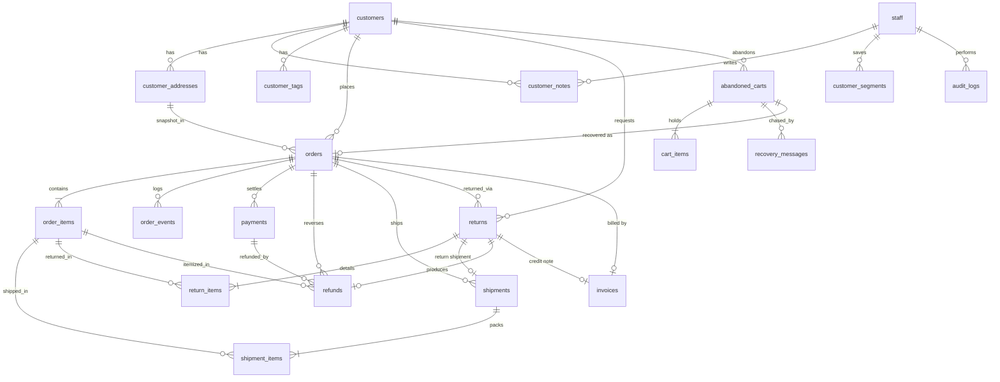

# SALES Phase 2 — خطة التخطيط (وثيقة تخطيطية فقط، لا تتضمن تنفيذ باك-إند)

> **النطاق:** الطلبات · المدفوعات · الشحنات · المرتجعات · السلات المتروكة · العملاء.
> **المصدر الحقيقي للحقول:** `packages/contracts/src/commerce/entities-*.ts` (الأنواع الحالية في الـ mock).
> **مصدر سلوك العمليات:** `packages/api-client/src/commerce/{orders,customers,order-math}.ts`.
> **ملاحظة:** كل المبالغ بالهللة (halalas — ريال = 100 هللة)، العملة SAR فقط، والأسعار **شاملة** ضريبة القيمة المضافة 15% (`pricesIncludeTax = true`).

## 1. مخطط قاعدة البيانات (DB Schema)

### 1.1 العملاء

#### `customers`
| العمود | النوع | القيود |
|---|---|---|
| `id` | `cus_*` text | **PK** |
| `name` | text | nullable (بعد حذف PDPL) |
| `phone` | varchar(20) E.164 | **NOT NULL · UNIQUE** |
| `email` | text | nullable · فهرس |
| `gender` | enum `male,female,unspecified` | default `unspecified` |
| `birth_date` | date | nullable |
| `notes` | text | legacy — تُرحّل لـ `customer_notes` |
| `marketing_consent` | jsonb `{whatsapp,sms,email,updatedAt}` أو 4 أعمدة bool + `consent_updated_at` | NOT NULL |
| `source` | enum `storefront,whatsapp,voice,manual,import,app` | NOT NULL |
| `created_at` | timestamptz | NOT NULL · فهرس |
| `orders_count` | int | derived — يُحدّث بمحفز/Job |
| `total_spent_halalas` | int | derived |
| `avg_order_halalas` | int | derived = `total_spent/orders_count` |
| `first_order_at` · `last_order_at` | timestamptz | derived · nullable · فهرس على `last_order_at` |
| `returns_count` | int | derived |
| `segment` | enum `new,returning,vip,at_risk` | فهرس — تُحسب بدورية |

**فهارس:** `UNIQUE(phone)` · `(email)` · `(segment)` · `(last_order_at)` · `(created_at)`.

#### `customer_addresses`
| العمود | النوع | القيود |
|---|---|---|
| `id` | `adr_*` | **PK** |
| `customer_id` | text | **FK → customers.id ON DELETE CASCADE** · فهرس |
| `label` | text | nullable |
| `recipient_name` | text | NOT NULL |
| `phone` | varchar(20) | NOT NULL |
| `city` | enum (23 مدينة — `SAUDI_CITIES`) | NOT NULL |
| `district` | text | NOT NULL |
| `street` · `building_number` · `additional_number` · `postal_code` · `short_address` | text | nullable |
| `lat` · `lng` | numeric(9,6) | nullable (زوج واحد أو لا شيء) |
| `notes` | text | nullable |
| `is_default` | bool | default false |

**قيود:** فهرس فريد جزئي `UNIQUE(customer_id) WHERE is_default` (عنوان افتراضي واحد كحد أقصى) · عند حذف الافتراضي تُرقّى أقدم عنوان (سلوك الـ mock: أول عنصر).

#### `customer_notes` (ملاحظات الموظفين — `staffNotes`)
| `id` PK · `customer_id` FK → customers · `staff_id` FK → staff · `text` text NOT NULL · `created_at` timestamptz |

#### `customer_tags`
| `customer_id` FK → customers · `tag` text | **PK (customer_id, tag)** — تُمنع التكرارات في الـ mock بفحص `includes` |

#### `customer_segments` (شرائح محفوظة — جديدة هذه الجولة)
| `id` `seg_*` PK · `name` text NOT NULL · `filters` jsonb (خريطة فلاتر `/customers` بدون `q`/`segment`) · `created_by` FK → staff · `created_at` |

---

### 1.2 الطلبات

#### `orders`
| العمود | النوع | القيود |
|---|---|---|
| `id` | `ord_*` | **PK** |
| `number` | serial int | **UNIQUE** غير قابل للتعديل |
| `customer_id` | text | **FK → customers.id RESTRICT** (الطلبات تبقى بعد حذف بيانات العميل) · فهرس |
| `channel` | enum `storefront,whatsapp,voice,manual,app` | NOT NULL |
| `agent_id` | text | nullable · FK → agents |
| `conversation_id` | text | nullable · FK → conversations |
| `shipping_address_id` | text | FK → customer_addresses SET NULL + `shipping_address` jsonb **snapshot** (تجميد العنوان وقت الطلب) |
| `shipping_method` | jsonb `{carrier,service,price,etaDays}` | nullable |
| `coupon_code` | text | nullable · FK → coupons.code |
| `subtotal` · `discount_total` · `shipping_total` · `tax_total` · `total` | int (هللة) | NOT NULL · `total = max(0, subtotal − discount + shipping)` |
| `prices_include_tax` | bool | default true |
| `payment_method` | enum `card,mada,apple_pay,stc_pay,cod,bank_transfer,payment_link` | NOT NULL |
| `payment_status` | enum `pending,authorized,paid,partially_refunded,refunded,failed,cod_pending,cod_collected` | فهرس |
| `fulfillment_status` | enum `unfulfilled,processing,shipped,delivered,returned,cancelled` | فهرس |
| `status` | enum `needs_action,in_progress,completed,cancelled` | فهرس |
| `customer_note` | text | nullable |
| `invoice_id` | text | nullable · FK → invoices |
| `paid_at` · `cancelled_at` | timestamptz | nullable |
| `cancel_reason` | jsonb `{code: customer_request|out_of_stock|fraud|payment_failed|other, text}` | nullable |
| `created_at` | timestamptz | فهرس |

**فهارس:** `(customer_id)` · `(status)` · `(payment_status)` · `(fulfillment_status)` · `(created_at DESC)` · `(channel)` · مركّب `(customer_id, created_at)`.

#### `order_items`
| العمود | النوع | القيود |
|---|---|---|
| `id` | `oi*` | **PK** |
| `order_id` | text | **FK → orders.id CASCADE** · فهرس |
| `variant_id` · `product_id` | text | FK → product_variants / products · فهرس على variant |
| `product_name` | jsonb `LocalizedText` | snapshot |
| `variant_label` · `sku` · `image` (jsonb MediaRef) | text/jsonb | snapshot |
| `quantity` | int | **CHECK > 0** |
| `unit_price` · `discount` · `tax` · `line_total` | int هللة | `line_total = unit_price × quantity` |
| `fulfilled_qty` · `returned_qty` · `refunded_qty` | int | **CHECK ≤ quantity** — سقف الاسترجاع لكل سطر `quantity − refundedQty` |

#### `order_events` (الخط الزمني)
| `id` `ev_*` PK · `order_id` FK · `type` enum (`created,paid,payment_failed,status_changed,shipment_created,shipment_updated,delivered,refunded,note_added,invoice_issued,message_sent,return_requested,cancelled,edited`) · `actor` jsonb `ActorRef` · `at` timestamptz · `data` jsonb · `link` jsonb EntityRef nullable | فهرس `(order_id, at)` |

#### `order_internal_notes` (فرعية — مشتقة من `internalNotes[]`)
| `id` PK · `order_id` FK · `staff_id` FK · `text` · `at` | (أو تبقى jsonb داخل orders — القرار للتنفيذ) |

---

### 1.3 المدفوعات والاستردادات

#### `payments`
| العمود | النوع | القيود |
|---|---|---|
| `id` | `pay_*` | **PK** |
| `order_id` | text | **FK → orders.id** · فهرس |
| `amount` | int هللة | NOT NULL |
| `method` | enum (نفس payment_method) | NOT NULL |
| `status` | enum `pending,authorized,captured,failed,voided` | `captured`/`voided` نهائيتان (`canApplyPaymentEvent`) |
| `provider` | text (`moyasar`,`cod`,…) | NOT NULL |
| `provider_ref` | text | **UNIQUE** — مرجع البوابة |
| `card_brand` · `card_last4` | text | nullable |
| `failure_reason` | text | nullable |
| `webhook_event_id` | text | nullable — مرساة dedupe آخر حدث مطبّق |
| `created_at` | timestamptz | |

**جدول مساعد:** `payment_webhook_events(event_id PK, provider, payload jsonb, processed_at)` — لأن البوابة ترسل at-least-once وبترتيب غير مضمون (الـ mock: `processedWebhookEvents` Set).

#### `refunds`
| العمود | النوع | القيود |
|---|---|---|
| `id` | `rfd_*` | **PK** |
| `payment_id` | text | FK → payments.id |
| `order_id` | text | FK → orders.id · فهرس |
| `amount` | int هللة | `> 0` و `≤ refundableBalance` |
| `reason` | text | NOT NULL |
| `status` | enum `pending,succeeded,failed` | |
| `restock` | bool | أعاد للمخزون؟ |
| `gateway_ref` | text (`re_*`) | مرجع البوابة |
| `idempotency_key` | text | **UNIQUE** nullable — إعادة نفس المفتاح ترجع نفس السجل (`findRefundByKey`) |
| `return_id` | text | nullable · FK → returns (مصدره مرتجع؟) |
| `actor` · `approved_by` | jsonb ActorRef / FK staff | |
| `created_at` | timestamptz | |
| `items` | jsonb `[{orderItemId,quantity}]` | تفصيلي — أو جدول `refund_items(return_id…)` لو احتجنا استعلامات |

**السقف الصلب:** `refundable = paidAmount − Σ refunds غير الفاشلة`؛ ولكل سطر `quantity − refundedQty`.

#### `shipments`
| العمود | النوع | القيود |
|---|---|---|
| `id` | `shp_*` | **PK** |
| `order_id` · `customer_id` | text | FK · فهارس |
| `type` | enum `outbound,return` | |
| `carrier` · `service` | text | |
| `tracking_number` · `tracking_url` · `label_url` · `label_number` | text | nullable · فهرس على tracking_number |
| `packages` | jsonb `[{weightGrams, dimensionsCm{l,w,h}}]` | |
| `cod_amount` | int هللة | nullable — مبلغ التحصيل عند الاستلام |
| `status` | enum `label_created,picked_up,in_transit,out_for_delivery,delivered,failed_attempt,returned,cancelled` | فهرس |
| `events` | jsonb `[{status,location,description,at}]` | أو جدول `shipment_events` لو لزم webhooks الناقل |
| `estimated_delivery` | text/date | nullable |
| `cost` | int هللة | |

#### `shipment_items`
| `shipment_id` FK → shipments · `order_item_id` FK → order_items · `quantity` int CHECK > 0 | **PK (shipment_id, order_item_id)** — يدعم الشحن الجزئي |

---

### 1.4 المرتجعات

#### `returns`
| العمود | النوع | القيود |
|---|---|---|
| `id` | `ret_*` | **PK** |
| `number` | serial | UNIQUE |
| `order_id` · `customer_id` | text | FK · فهارس |
| `reason` | enum `damaged,wrong_item,not_as_described,size_issue,changed_mind,other` | |
| `customer_note` · `photos` jsonb MediaRef[] | | nullable |
| `status` | enum `requested,approved,rejected,in_transit,received,refunded,closed` | فهرس |
| `resolution` | enum `refund,exchange,store_credit` | nullable |
| `refund_amount` | int هللة | nullable |
| `restock` | bool | |
| `return_shipment_id` | FK → shipments (type=return) | nullable |
| `rejection_reason` | text | nullable |
| `credit_note_id` | FK → invoices(type=credit_note) | nullable |
| `refund_id` | FK → refunds | nullable — يربط حركة المال |
| `inspection_status` | enum `pending,passed,failed` | nullable — فحص المستودع (المال لا يتحرك إلا بعد `received`) |
| `restocked_at` | timestamptz | nullable |
| `created_at` | timestamptz | |

#### `return_items`
| `id` PK · `return_id` FK → returns · `order_item_id` FK → order_items · `quantity` int CHECK > 0 · `reason` enum (نفس ReturnReason) | سقف: `quantity ≤ order_item.quantity − returned_qty` |

---

### 1.5 السلات المتروكة

#### `abandoned_carts`
| `id` `cart_*` PK · `customer_id` FK → customers SET NULL (سلة ضيف) · `phone` varchar NOT NULL · `total` int هللة · `abandoned_at` timestamptz فهرس · `recovery_status` enum `not_contacted,message_sent,recovered,lost` فهرس · `recovered_order_id` FK → orders nullable |

#### `cart_items`
| `cart_id` FK → abandoned_carts · `variant_id` FK · `product_id` FK · `name` jsonb · `image` jsonb · `quantity` int · `price` int هللة | **PK (cart_id, variant_id)** |

#### `recovery_messages` (`recoveryAttempts`)
| `id` PK · `cart_id` FK → abandoned_carts · `channel` enum `whatsapp,sms,email` · `agent_id` FK → agents nullable · `at` timestamptz · `opened` bool | فهرس `(cart_id, at)` |

#### `audit_logs`
| `id` `aud_*` PK · `actor` jsonb ActorRef (أو actor_type+actor_id) · `action` text فهرس (`order.created`, `cart.recovery_sent`…) · `target` jsonb EntityRef nullable · `changes` jsonb `[{field,from,to}]` · `ip` inet nullable · `at` timestamptz فهرس · `conversation_id` nullable (مصدرها copilot) |

---

## 2. قواعد العمل (Business Rules) — مستخرجة من `order-math.ts` و`orders.ts`

### 2.1 حساب الإجماليات (tax-inclusive)
```
subtotal      = Σ unitPrice × quantity
discountTotal = clamp(discount, 0, subtotal)          // الكوبون لا يتجاوز الإجمالي
total         = max(0, subtotal − discount + shippingFee)
taxTotal      = total − round(total / 1.15)           // حصة الـ VAT المضمّنة 15%
```
لكل سطر `lineTotal = unitPrice × quantity` و `tax = vatIncluded(lineTotal)`.

### 2.2 دورة حياة الطلب
- **`status`:** `needs_action → in_progress → completed` (+ `cancelled` نهائية).
- **`fulfillmentStatus`:** تقدّم للأمام فقط `unfulfilled → processing → shipped → delivered` (القفز مسموح، الرجوع ممنوع — `canTransitionFulfillment`)؛ `returned`/`cancelled` نهائيتان.
- **الإلغاء (`canCancelOrder`):** ممنوع بعد `shipped/delivered/returned` ولا يُلغى الملغى. عند الإلغاء: إعادة مخزون `(quantity − returnedQty)` بحركة `cancellation`، واسترداد اختياري حتى `refundableBalance`.
- **الشحن (`canShipOrder`):** إنشاء شحنة فقط والطلب مفتوح وغير `shipped/delivered/cancelled`؛ الشحن الجزئي عبر `shipment_items`.
- **إنشاء الطلب:** بوابة المخزون — صنف فيزيائي متتبّع لا يُباع فوق المتاح (`insufficient_stock:SKU`) → ثم خصم بحركة `sale`، إنشاء سطر `payment`، تحديث `customer.stats.ordersCount`، تسجيل `order_events` + `audit_logs`.

### 2.3 حالات الدفع
- **`Payment.status`:** `pending → authorized → captured` أو `failed`؛ `voided` للإلغاء قبل الالتقاط. `captured`/`voided` **نهائيتان** — الأحداث المتأخرة/المكررة لا تُرجع الحالة (`canApplyPaymentEvent`).
- **`Order.paymentStatus`:** مشتقة `pending/authorized/paid/partially_refunded/refunded/failed` + مسار COD `cod_pending → cod_collected`.
- **Webhook dedupe:** `event_id` فريد → إعادة الإرسال تُقرّ بدون تطبيق (`{applied:false, duplicate:true}`).
- **`paidAmount`:** مجموع مدفوعات `captured`، مع fallback لـ `order.total` في البيانات المزروعة المدفوعة بلا سجلات.
- **Idempotency:** `refunds.idempotency_key` يمنع ازدواج الاسترداد.

### 2.4 دورة المرتجع + قواعد القبول (`canTransitionReturn`)
```
requested → approved | rejected → closed
approved → in_transit → received → refunded → closed
```
- **القبول:** `requested` فقط؛ القرار: `refund|exchange|store_credit` + `restock` + إنشاء شحنة إرجاع اختيارية (`type=return`).
- **المال بعد الفحص:** `refunded` لا يأتي إلا من `received` — المبلغ `≤ refundableBalance` والكمية `≤ qty − returnedQty` لكل سطر.
- **المخزون:** `restockedAt` يُضبط عند كتابة الوحدات للمخزون (حركة `return`).
- **الاتجاه الواحد:** لا رجوع ولا إعادة قرار؛ `rejected→closed` مباشرة.

### 2.5 دورة السلة المتروكة + قواعد الاستعادة
- **عتبة التخلي:** السلة لا تصبح "متروكة" إلا بعد `settings.delay` (`1h`/`24h`) من `abandoned_at` — رسالة قبل الأوان = `cart_not_due`.
- **Dedupe:** لا رسالة ثانية داخل نافذة التأخير (`recovery_recent`)؛ الإرسال اليدوي بعد انقضائها مسموح ويُسجّل محاولة جديدة.
- **الحالات:** `not_contacted → message_sent → recovered | lost`؛ المغلقة (`recovered`/`lost`) ترفض `closed`.
- **الإعدادات:** `autoRecovery` · `delay` · `agentId` · `couponId` (كوبون تحفيزي اختياري) — الإرسال الفعلي عبر وكيل WhatsApp.

### 2.6 الشرائح
- **ثابتة (enum):** `new/returning/vip/at_risk` تُشتق من الإحصائيات بدورية.
- **جاهزة محسوبة (client):** `new` = تسجيل ≤30 يوم · `repeat` = طلبات ≥2 · `top_spenders` = إنفاق ≥5,000 ر.س · `inactive` = آخر نشاط >90 يوم · `high_order_count` = طلبات ≥5.
- **مخصصة:** لقطة فلاتر محفوظة في `customer_segments` وتُطبّق عبر `?segment=saved:<id>`.

---

## 3. تخطيط الـ API (مشتق من سطح `commerce.*`)

**الاتفاق العام:** `v1` prefix · استجابة `{data, meta:{page,pageSize,total}}` للقوائم · خطأ `{error:{code,message,details?}}` · الفرز whitelist (`?sort=-created_at|total|…`) · ترقيم `?page=&pageSize=` (أو cursor للجداول الثقيلة) · Auth: Bearer لجلسة الموظف + صلاحية لكل endpoint · Webhooks: توقيع HMAC + `event_id` idempotent.

### 3.1 الطلبات
| الطريقة + المسار | الـ mock | المدخلات (validation) | الاستجابة / الأخطاء |
|---|---|---|---|
| GET `/orders` | `orders.list` | `q,status,paymentStatus,fulfillmentStatus,channel,customerId,coupon,from,to,sort,page` | صفحة Order[] · `orders.read` |
| GET `/orders/{id}` | `orders.get` | — | Order أو 404 · `orders.read` |
| POST `/orders` | `orders.create` | NewOrderInput: `customerId,addressId,items[{variantId,quantity,unitPrice?}],shippingFee,discount,paymentMethod,markPaid?,couponCode?,internalNote,sendPaymentLink,conversationId?` | 201 Order · 422 `address/variant/quantity/insufficient_stock:{sku}` · `orders.manage` |
| POST `/orders/{id}/notes` | `orders.addNote` | `{text}` | `orders.manage` |
| POST `/orders/{id}/fulfill` | `orders.fulfill` | — | `orders.manage` |
| POST `/orders/{id}/shipments` | `orders.createShipment` | ShipmentInput `{carrier,service,weightGrams,items?,packages?,pickupDate?,cost?}` | `orders.manage`/`shipments.manage` |
| PATCH `/orders/fulfillment` | `orders.setFulfillment` | `{ids[],to}` — فحص `canTransitionFulfillment` لكل طلب | `orders.manage` |
| POST `/orders/tags` | `orders.addTag/removeTag` | `{ids[],tag}` | `orders.manage` |
| PATCH `/orders/{id}/address` | `orders.updateAddress` | Partial\<Address\> | `orders.manage` |
| POST `/orders/{id}/payment-link` | `orders.sendPaymentLink` | — | `orders.manage` |
| POST `/orders/{id}/cancel` | `orders.cancel` | `{code,text,refund,restock,notify}` | 422 `already_cancelled/shipped` · `orders.manage` |
| POST `/orders/{id}/refunds` | `orders.refund` | RefundInput `{amount,reason,restock?,items?,idempotencyKey?}` | 422 فوق السقف · `orders.refund` |
| GET `/orders/{id}/payments` · `/refunds` | `orders.payments/refunds` | — | `orders.read` |

### 3.2 Webhook البوابة
`POST /webhooks/payments/{provider}` — body `{eventId,providerRef,type:authorized|captured|failed|voided,signature}` → `{applied,duplicate}` · تحقق توقيع + dedupe `event_id` + `canApplyPaymentEvent`.

### 3.3 الشحنات · الفواتير · المرتجعات
| المسار | الـ mock | ملاحظات |
|---|---|---|
| GET `/shipments` · `/{id}` | `shipments.list/get` | `orders.read` |
| PATCH `/shipments/{id}/status` | `shipments.setStatus` | `shipments.manage` + كتابة `order_events` |
| POST `/webhooks/carriers/{carrier}` | (مخطط) | تحديث `shipments.events` + status |
| GET `/invoices` · `/{id}` · POST `/{id}/resend` | `invoices.*` | `invoices.read` · الإصدار/الإرسال لـ ZATCA |
| GET `/returns` · `/{id}` | `returns.list/get` | `orders.read` |
| PATCH `/returns/{id}/status` | `returns.setStatus` | `canTransitionReturn` + extras `{rejectionReason,refundAmount,restock,resolution}` · `returns.manage` |
| POST `/returns/{id}/approve` | `returns.approve` | `{resolution,refundAmount,restock,createShipment}` |
| POST `/returns/{id}/refund` | `returns.refund` | ينشئ Refund مربوط `return_id` |

### 3.4 السلات المتروكة
GET `/abandoned-carts` · `/{id}` (`orders.read`) · POST `/{id}/recovery` (`marketing.manage` — أخطاء `cart_not_due/recovery_recent/closed`) · GET/PATCH `/settings/cart-recovery`.

### 3.5 العملاء
| المسار | الـ mock | ملاحظات |
|---|---|---|
| GET `/customers` | `customers.list` | فلاتر `q,segment(=enum|preset:*|saved:*),city,source,tag,consent,minOrders,minSpent,maxSpent,period` · `customers.read` |
| POST `/customers` | `customers.create` | `{name,phone}` — 409 `phone_taken` |
| GET/PATCH `/customers/{id}` | `get`/`update` | patch: name,email,gender,birthDate,notes,tags,marketingConsent |
| DELETE `/customers/{id}` | `customers.remove` | **أنيمة PDPL** — لا حذف فيزيائي (الطلبات/الفواتير تبقى) |
| POST `/customers/{id}/addresses` | `addAddress` | حقول Address · `isDefault` يُسقط بقية الافتراضيات |
| PATCH/DELETE `/customers/{id}/addresses/{adrId}` | `updateAddress`/`removeAddress` | حذف الافتراضي يرقّي الأول |
| POST `/customers/{id}/addresses/{adrId}/default` | `setDefaultAddress` | |
| POST `/customers/tags` · DELETE | `addTag`/`removeTag` | bulk `{ids[],tag}` |
| POST `/customers/{id}/notes` | `addNote` | staffNotes |
| GET/POST/DELETE `/customer-segments` | `customerSegments.*` | `{name,filters}` |
| GET `/customers/export.csv` | (مخطط — حالياً client-side) | `customers.export` + تسجيل audit |

---

## 4. مصفوفة الصلاحيات (roles × actions)

| الإجراء | owner | admin | orders | support | marketing | catalog | readonly |
|---|---|---|---|---|---|---|---|
| قراءة الطلبات/المرتجعات/الشحنات | ✅ | ✅ | ✅ | ✅ | — | — | ✅ |
| إنشاء/تعديل/إلغاء الطلب (`orders.manage`) | ✅ | ✅ | ✅ | — | — | — | — |
| استرداد (`orders.refund`) | ✅ | ✅ | ✅ | — | — | — | — |
| تعديل الأسعار (`prices.update`) | ✅ | ✅ | ✅ | — | — | — | — |
| الشحنات (`shipments.manage`) | ✅ | ✅ | ✅ | — | — | — | — |
| المرتجعات (`returns.manage`) | ✅ | ✅ | ✅ | ✅ | — | — | — |
| الفواتير (`invoices.read`) | ✅ | ✅ | ✅ | — | — | — | ✅ |
| العملاء قراءة (`customers.read`) | ✅ | ✅ | ✅ | ✅ | ✅ | — | ✅ |
| العملاء إدارة — إنشاء/عناوين/وسوم/ملاحظات/شرائح (`customers.manage`) | ✅ | ✅ | — | — | — | — | — |
| تصدير العملاء (`customers.export`) | ✅ | ✅ | — | — | ✅ | — | — |
| السلات/إعدادات الاستعادة (`marketing.manage`) | ✅ | ✅ | — | — | ✅ | — | — |
| التقارير (`reports.read`) | ✅ | ✅ | — | — | ✅ | — | ✅ |

> ملاحظة تنفيذية: حالياً `customers.manage` ليس ضمن دور `orders` — إن كان مسار "إنشاء عميل أثناء الطلب" مطلوباً لموظف الطلبات، تُضاف الصلاحية للدور أو يُكتفى بدعم `support`. قرار منتج — موثّق هنا.

## 5. تخطيط التكاملات

### 5.1 يحتاج باك-إند حقيقي (داخلي)
- **الجلسات/الصلاحيات:** auth + `requestContext` (الـ mock يحقنها من الواجهة) + RBAC.
- **المعاملات:** إنشاء طلب = (items + totals + payment + stock movement + event + customer stats) ذرّياً — الـ mock يفعلها تسلسلياً بدون isolation.
- **الترقيم/الفرز/الفلترة** على السيرفر (حالياً كله client-side على القائمة الكاملة).
- **الأرقام التسلسلية** (`order.number`, `return.number`) — sequence آمنة concurrently.
- **الويبهوكس الواردة** + جدول `payment_webhook_events` + توقيع.
- **مجدول السلات:** Job يفحص `abandoned_at + delay` ويُرسل تلقائياً (`autoRecovery`).
- **حساب الشرائح/الإحصائيات** المشتقة (segment, stats) دورياً.
- **تصدير CSV** على السيرفر + audit + رابط موقّت.

### 5.2 تكاملات خارجية
| المجال | المزود المقترح | ملاحظات |
|---|---|---|
| بوابة الدفع | **Moyasar** / HyperPay / Tap | mada · Apple Pay · STC Pay · بطاقات — auth/capture/void/refund + webhooks موقّعة |
| BNPL | **Tabby · Tamara** (موجودان كتطبيقات في الـ marketplace) | payment method + webhooks |
| COD | داخلي + تسوية الناقل | `cod_pending → cod_collected` عند تسليم الشحنة |
| الشحن | **أرامكس · SMSA** مباشرة أو مجمّع **Torod** | إنشاء بوليصة (label) · tracking webhooks · خدمة COD |
| المراسلة | **WhatsApp Business Cloud API** (+ SMS: Unifonic/Taqnyat · بريد: SES) | قوالب معتمدة للاستعادة/الإشعارات · `opened` من callbacks |
| الفوترة | **هيئة الزكاة ZATCA (فاتورة)** | simplified/standard + credit_note · `zatcaStatus` reported/cleared · QR TLV |
| الامتثال | **PDPL** | تصدير بيانات العميل + anonymization (موجود منطقه) + سجل تدقيق |
| الاستيراد | سلة/زد connectors | `imports` موجود (products/customers/inventory) |

## 6. ERD (Mermaid)



## 7. حقول/بذور مطلوبة (لم تُعدّل هذه الجولة — البذور خارج النطاق)

التحقق الحالي: **30 عميلاً** في `seed/people.ts` ✓ (يغطي العتبة). للجولة القادمة على البذور يُستحسن:
1. عميل واحد على الأقل **بعنوانين** (لعرض تبديل الافتراضي بشكل واقعي).
2. `staffNotes` جاهزة لعميلَين (اختياري — الحقل optional ويملأ من الواجهة).
3. شريحة محفوظة واحدة (`customer_segments`) كمثال.
4. ضمان وجود عملاء يطابقون كل preset: `inactive` (lastOrderAt >90يوم) · `top_spenders` (≥5,000 ر.س) · `high_order_count` (≥5) — أغلبها مغطى حالياً عبر توليد الطلبات لكن يُثبَّت عمداً.
5. مراجعة: `notes` القديم يُرحّل لـ `customer_notes` عند التطبيق الحقيقي.
